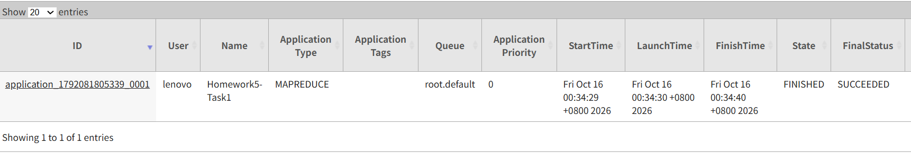
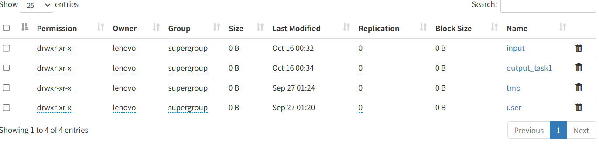
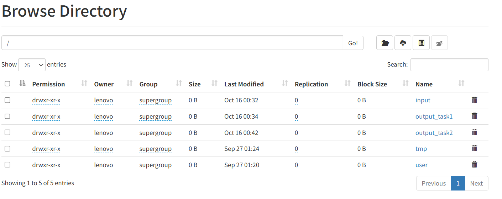
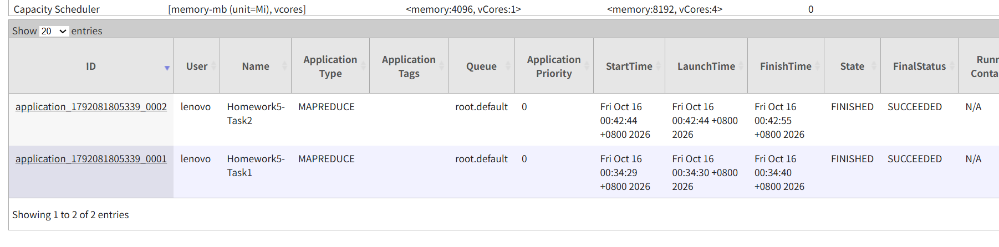

# 金融大数据处理技术：作业 5

## 作业内容

使用 Hadoop MapReduce 处理 `A.txt` 和 `B.txt`，比较指数编号 101、102、103 下的股票集合关系，并进行二次统计。

- **任务一**：对每个“指数编号 + 股票代码”输出关系标记 `BOTH`、`A_ONLY` 或 `B_ONLY`。
- **任务二**：读取任务一结果，统计每个指数的交集数量、A 独有数量、B 独有数量和并集数量。

## 运行环境

- WSL Ubuntu
- Java 17
- Maven
- Hadoop 3.5.0，伪分布式模式，使用 HDFS 和 YARN

运行前应已配置 `JAVA_HOME`、`HADOOP_HOME` 和相关命令的 `PATH`，并完成 HDFS 首次初始化及本机免密 SSH 配置。Hadoop 服务已经启动时，可以直接准备输入并运行任务。

## 项目结构

```text
.
├── src/
│   ├── Task1Driver.java
│   └── Task2Driver.java
├── target/
│   └── homework5.jar
├── input/
│   ├── A.txt
│   └── B.txt
├── output/
│   ├── output_task1/
│   │   ├── part-r-00000
│   │   └── _SUCCESS
│   └── output_task2/
│       ├── part-r-00000
│       └── _SUCCESS
├── docs/
│   ├── screenshots/
│   └── reference/作业5.pdf
├── pom.xml
├── .gitignore
└── README.md
```

## 设计思路

任务一的 Mapper 从输入分片获取文件名，识别记录来自 `A.txt` 还是 `B.txt`，以“指数编号 + 股票代码”为组合键，以文件来源为值。Reducer 判断该组合键是否出现过 A、B 两个来源，生成关系标记。同一来源内的重复记录不会增加输出记录数；不同指数中的同一股票分别处理。

任务二以指数编号为键，以任务一的关系标记为值，分别统计 `BOTH`、`A_ONLY`、`B_ONLY` 的数量，再相加得到并集数量。

输入支持空格或制表符分隔，输出使用制表符分隔。两个任务分别使用一个 Reducer；任务一按指数编号、股票代码排序，任务二按指数编号排序。本题指数编号等长，使用 `Text` 的默认排序即可。

## 编译与运行

以下命令均在 **WSL 终端的项目根目录**执行，即当前目录中能看到 `pom.xml`、`src/` 和 `input/`。请在同一个终端中依次操作，以保留运行路径变量。

本地文件使用相对于项目根目录的路径，例如 `./input/A.txt`；HDFS 使用相对于当前用户 HDFS 主目录的路径，例如 `homework5/运行编号/input`。两者属于不同的文件系统，不会因为目录名称相似而自动同步。

### 1. 设置编码并编译

中文项目目录需要使用 UTF-8 locale。在调用 Java、Maven 和 Hadoop 前设置：

```bash
export LANG=C.UTF-8
export LC_ALL=C.UTF-8

mvn clean package
jar tf ./target/homework5.jar
```

出现 `BUILD SUCCESS` 后，`./target/homework5.jar` 中应包含 `Task1Driver.class`、`Task2Driver.class` 及各自的 Mapper、Reducer 类。修改源码后需要重新打包。

### 2. 启动 Hadoop

如果 HDFS、YARN 尚未启动，执行：

```bash
sudo service ssh start
"$HADOOP_HOME/sbin/start-dfs.sh"
"$HADOOP_HOME/sbin/start-yarn.sh"

jps
hdfs dfsadmin -report
yarn node -list
```

应能看到 NameNode、DataNode、ResourceManager 和 NodeManager 等进程，并确认存在可用的数据节点与 YARN 节点。已有的 HDFS 不需要重新格式化。

Web 页面：

- NameNode：<http://localhost:9870>
- ResourceManager：<http://localhost:8088>

本机为单节点 WSL 环境，已将 `dfs.datanode.hostname` 配置为 `localhost`，供 Windows 浏览器访问 DataNode 下载链接。该配置属于本机 Hadoop 环境，克隆仓库不会自动修改其他机器的配置。

### 3. 上传输入

为每轮运行生成独立的 HDFS 路径，避免与旧输出冲突：

```bash
RUN_ID=$(date +%Y%m%d_%H%M%S)
HDFS_RUN="homework5/$RUN_ID"

hdfs dfs -mkdir -p "$HDFS_RUN/input"
hdfs dfs -put ./input/A.txt ./input/B.txt "$HDFS_RUN/input/"
hdfs dfs -ls "$HDFS_RUN/input"
```

输入目录只放 `A.txt`、`B.txt`，保留文件名以便任务一识别来源。只创建输入目录，任务的输出目录由 Hadoop 自动创建。

### 4. 运行任务一

```bash
hadoop jar ./target/homework5.jar Task1Driver \
    "$HDFS_RUN/input" \
    "$HDFS_RUN/output_task1"

hdfs dfs -cat "$HDFS_RUN/output_task1/part-r-00000"
```

输出字段依次为：指数编号、股票代码、关系标记。

### 5. 运行任务二

任务一成功完成后，继续使用同一轮路径：

```bash
hadoop jar ./target/homework5.jar Task2Driver \
    "$HDFS_RUN/output_task1" \
    "$HDFS_RUN/output_task2"

hdfs dfs -cat "$HDFS_RUN/output_task2/part-r-00000"
```

输出字段依次为：指数编号、交集数量、A 独有数量、B 独有数量、并集数量。

两个入口类分别从 `args[0]`、`args[1]` 获取输入、输出路径，源码没有写死本地目录、HDFS 绝对路径或 Hadoop 安装位置。这里的相对 HDFS 路径由 Hadoop 根据当前用户的 HDFS 主目录解析。

重新打开终端后，需重新设置编码，并将 `HDFS_RUN` 设为已有任务实际使用的 `homework5/运行编号`，再继续查看结果或运行任务二。

## 本次运行结果

任务一结果位于 [output/output_task1/part-r-00000](output/output_task1/part-r-00000)，共 547 行，按指数编号、股票代码升序排列。

任务二结果位于 [output/output_task2/part-r-00000](output/output_task2/part-r-00000)：

| 指数编号 | 交集数量 | A 独有数量 | B 独有数量 | 并集数量 |
| --- | --- | --- | --- | --- |
| 101 | 3 | 13 | 4 | 20 |
| 102 | 3 | 19 | 3 | 25 |
| 103 | 52 | 195 | 255 | 502 |

两个结果文件均来自实际运行，已核对与输入集合一致。下方截图对应最初运行时 HDFS 根目录下的 `output_task1`、`output_task2`；上面的复现命令使用每轮独立的相对 HDFS 路径，以避免覆盖旧结果。

## 运行截图

任务一在 YARN 中运行成功：



任务一输出目录已生成：



两个任务的 HDFS 输出目录：



两个任务在 YARN 中的最终结果均为 `SUCCEEDED`：



## 可改进之处

当前每个任务使用一个 Reducer，适合小规模输入。数据量增大时，可以增加 Reducer 数量，并结合分区和全局排序方案保持结果顺序；任务二还可以在类型兼容的前提下使用局部聚合减少传输量。也可根据节点资源调整容器内存、压缩中间结果，以改善运行效率。
